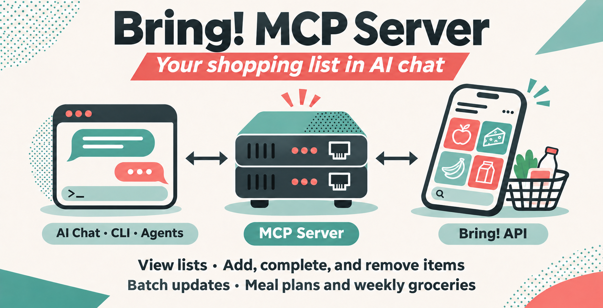

# Bring! MCP Server



Bring! shopping lists in Codex, Claude Code, Claude Desktop, and other local [MCP](https://modelcontextprotocol.io/) clients.

Read lists, add groceries, mark items as purchased, or preview a batch of changes before applying it.

[Install](#1-install-the-server) · [Credentials](#2-add-your-credentials) · [Connect](#3-connect-your-client) · [Tools](#tools) · [Development](#development)

## 1. Install the server

You need a Bring! account. Choose one installation method:

<details>
<summary><strong>Download an executable</strong> · no Python required</summary>

Download and extract an archive from [GitHub Releases](https://github.com/arithmetic-zz/bring-mcp-server/releases/latest) into a permanent folder. Python and dependencies are included.

| Download suffix | Target |
| --- | --- |
| `macos-arm64.tar.gz` | macOS 15+ on Apple Silicon |
| `macos-x86_64.tar.gz` | macOS 15+ on Intel |
| `linux-x86_64.tar.gz` | Ubuntu 22.04+ or compatible glibc-based Linux |
| `windows-x86_64.zip` | Windows 10/11, 64-bit Intel/AMD |

Checksums are in `SHA256SUMS`. Downloads are unsigned and not notarized; macOS or Windows may require you to approve the executable.

</details>

<details>
<summary><strong>Run from source</strong> · Python 3.11+ and Git required</summary>

**macOS / Linux**

```bash
git clone https://github.com/arithmetic-zz/bring-mcp-server.git
cd bring-mcp-server
python3 -m venv .venv
.venv/bin/python -m pip install -r requirements.txt
```

**Windows (PowerShell)**

```powershell
git clone https://github.com/arithmetic-zz/bring-mcp-server.git
cd bring-mcp-server
py -3 -m venv .venv
.venv\Scripts\python.exe -m pip install -r requirements.txt
```

</details>

## 2. Add your credentials

In the extracted folder or source checkout, copy `.env.example` to `.env`:

```bash
cp .env.example .env
```

On Windows, use `Copy-Item .env.example .env` in PowerShell.

Open `.env` in a text editor and enter your Bring! login:

```env
BRING_EMAIL=your@email.com
BRING_PASSWORD=your-password
```

Save `.env` beside the executable, or beside `server.py` for a source installation. Existing environment variables override the file.

Keep credentials private. `.env` is ignored by Git.

## 3. Connect your client

Your client starts the server automatically over stdio. Expand its instructions below.

Use absolute paths in every example. On Windows, use `bring-mcp-server.exe` or `.venv\Scripts\python.exe`; the CLI commands work on one line in Bash or PowerShell.

<details>
<summary><strong>Codex</strong> · CLI and IDE extension</summary>

Install and sign in to the Codex CLI using the [official quickstart](https://learn.chatgpt.com/docs/quickstart). Register Bring with one of these commands.

**Standalone download**

```bash
codex mcp add bring -- "/absolute/path/to/bring-mcp-server"
```

**Source installation**

```bash
codex mcp add bring -- "/path/to/bring-mcp-server/.venv/bin/python" "/path/to/bring-mcp-server/server.py"
```

Start a new Codex session or restart the IDE extension. Run `codex mcp list` to check registration, then `/mcp` inside the CLI to check the connection.

Ask Codex: “List my Bring! shopping lists.”

The CLI and IDE extension share configuration. For manual `config.toml` setup, see the [official Codex MCP documentation](https://learn.chatgpt.com/docs/extend/mcp?surface=cli).

</details>

<details>
<summary><strong>Claude Code</strong></summary>

Install and sign in to Claude Code using the [official quickstart](https://code.claude.com/docs/en/quickstart). Register Bring with one of these commands.

**Standalone download**

```bash
claude mcp add --transport stdio --scope user bring -- "/absolute/path/to/bring-mcp-server"
```

**Source installation**

```bash
claude mcp add --transport stdio --scope user bring -- "/path/to/bring-mcp-server/.venv/bin/python" "/path/to/bring-mcp-server/server.py"
```

`--scope user` makes Bring available across your projects. Open Claude Code and check the connection with `/mcp` or run `claude mcp get bring` in your terminal.

Ask Claude: “List my Bring! shopping lists.”

See the [official Claude Code MCP documentation](https://code.claude.com/docs/en/mcp) for other scopes and troubleshooting.

</details>

<details>
<summary><strong>Claude Desktop</strong></summary>

[Install Claude Desktop](https://claude.ai/download), then open **Settings → Developer → Edit Config**. Add `bring` to the existing `mcpServers` object in `claude_desktop_config.json`, or use this full example if the file is empty:

```json
{
  "mcpServers": {
    "bring": {
      "command": "/absolute/path/to/bring-mcp-server",
      "args": []
    }
  }
}
```

For a source checkout, replace the `bring` entry with:

```json
{
  "command": "/path/to/bring-mcp-server/.venv/bin/python",
  "args": ["/path/to/bring-mcp-server/server.py"]
}
```

In Windows JSON paths, escape backslashes as `\\`, for example `C:\\Tools\\bring-mcp-server.exe`. Both examples load credentials from `.env`.

Save the file, fully quit Claude Desktop, and reopen it.

Ask Claude: “List my Bring! shopping lists.” See the [local MCP server guide](https://modelcontextprotocol.io/docs/develop/connect-local-servers) for more details.

</details>

**If the connection fails:** Check the executable path, `.env` location, and credentials, then restart the client. For source installations, use the virtual environment's Python. Registration alone does not verify your Bring! login; the list request does.

## Tools

| Tool | Action |
| --- | --- |
| `get_lists` | List shopping lists and their UUIDs |
| `get_list` | Read a list, optionally filter items or omit history |
| `search_items` | Search across all lists |
| `add_item` | Add, update, or restore an item |
| `complete_item` | Move an item to Recently Purchased |
| `remove_item` | Delete an item completely |
| `batch_update` | Combine ADD, COMPLETE, and REMOVE operations |

Select lists by `list_uuid` or exact `list_name`. Mutations accept `dry_run: true` to preview without writing. Item attributes are read-only; edit them in the Bring app.

Resources expose `bring://lists` and `bring://lists/{listUuid}`. The `meal_plan` and `weekly_groceries` prompts help plan groceries.

The [full tool reference](https://github.com/arithmetic-zz/bring-mcp-server/blob/main/docs/tool-reference.md) covers arguments, matching rules, JSON responses, batch validation, and API errors.

## Development

After installing from source:

```bash
.venv/bin/python -m py_compile server.py
.venv/bin/python -m unittest discover -s tests -v
.venv/bin/python -m pip check
```

Tests mock Bring access and need no credentials. CI runs on Python 3.11–3.13. See the [development guide](https://github.com/arithmetic-zz/bring-mcp-server/blob/main/docs/development.md) for Inspector checks and release builds, and [AGENTS.md](https://github.com/arithmetic-zz/bring-mcp-server/blob/main/AGENTS.md) for contributor conventions.

## License

MIT
